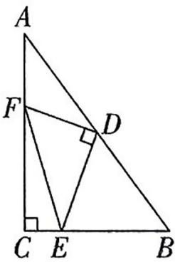

<!-- question-source:start -->
7 [2025 辽宁抚顺质检,较难] 如图,在 Rt $\triangle ABC$ 中, $\angle ACB=90^{\circ},D$ 为 AB 中点,点 E 在 BC 边上(点 E 不与点 B,C 重合),连接 DE,过点 D 作 $DF\perp DE$ 交 AC 于点 F,连接 EF.

(1)试说明: ${AF}^{2} + B{E}^{2} = E{F}^{2}$ ;

(2) 若 $AC = 7, BC = 5, EC = 1$ , 直接写出 $AF$ 的长.

<!-- question-source:end -->

![[Q00105083A1]]
