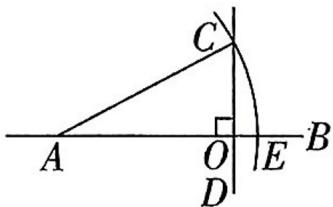

<!-- question-source:start -->
2. [2025 河南安阳质检]如图, 直线 $AB \perp CD$ , 垂足为 $O$ , $AO = 15$ , $CO = 8$ , 以点 $A$ 为圆

心,AC的长为半径画弧,交直线AB于点E,则OE的长为 ( )
A.8 B.6 C.4 D.2
<!-- question-source:end -->

![[Q00105784A1]]
