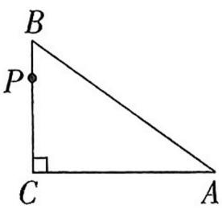
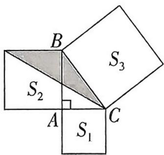

<!-- question-source:start -->
1. [2025 山东淄博期中, 中]如图, 点 $P$ 为 Rt $\triangle ABC$ 的边 $BC$ 上一点, 已知 $PC = 5$ , $AC = 10$ , 折线 $P - B - A$ 与折线 $P - C - A$ 的长度相等, 则边 $BC$ 的长为 ( ) A. 6.5 B. 7 C. 7.5 D. 8

(第1题图)
(第2题图)
<!-- question-source:end -->

![[Q00105785A1]]
