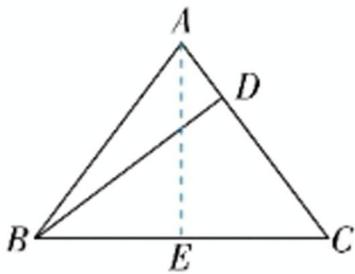

> [!success]- 必刷题
>
> > [!success] **【答案】** C
>
> > [!note]- **【解析】**
> > 如图, 过 A 作 $AE \perp BC$ 于点 E. 因为 $AB = AC, AE \perp BC$ , 所以 $EB = EC = \frac{1}{2} CB = 3$ . 在
> >
> > 
> >
> > Rt $\triangle ABE$ 中， $AE^2 = AB^2 - BE^2 = 5^2 - 3^2 = 16$ ，所以 $AE = 4$ ，所以 $\triangle ABC$ 的面积为 $\frac{1}{2}\cdot BC\cdot AE =$
> >
> > 易错警示
> > 已知直角三角形的两条边长，求第三条边长的平方时，如果题中没有说明较长边长是直角边长还是斜边长，那么要分两种情况讨论，注意不要漏解.
> >
> > 思路分析
> > 过点A作AH⊥BM于H,利用勾股定理先求出BH=4cm,再分当 $\angle APB=90^{\circ}$ 时和当 $\angle BAP=90^{\circ}$ 时两种情况讨论求解即可.
> >
> > $\frac{1}{2}\times6\times4=12$ , 所以 $\frac{1}{2}\cdot AC\cdot BD=12$ , 即 $\frac{1}{2}\times5\times$ BD=12, 解得 BD=4.8.
> >
> > 故选 **C**.
