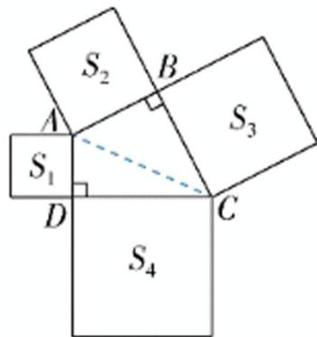

> [!success]- 必刷题
>
> > [!success] **【答案】** 18
>
> > [!note]- **【解析】**
> > 如图，连接 $AC$ 。因为 $S_{1} = 8, S_{2} = 11$ ， $S_{3} = 15$ ，所以 $AD^{2} = 8$ ， $AB^{2} = 11, BC^{2} = 15$ 。在 Rt△ABC 与 Rt△ADC 中，由勾股定理得 $AC^{2} =$
> >
> > 
> >
> > $AB^{2} + BC^{2} = 26, CD^{2} = AC^{2} - AD^{2}$ , 所以 $CD^{2} = 26 - 8 = 18$ , 所以 $S_{4} = 18$ . 故答案为 18.
> >
> > 或34 【解析】因为一个直角三角形的两条边长分别为3和5，所以①当5是此直角三角形的斜边长时，设另一条直角边长为 $x$ ，则由勾股定理，得 $x^{2} = 5^{2} - 3^{2} = 16$ ；
> > - **②**：当5是此直角三角形的直角边长时，设斜边长为 $y$ ，则由勾股定理，得 $y^{2} = 5^{2} + 3^{2} = 34.$ 故答案为16或34.
