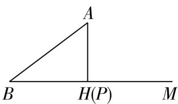
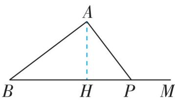

> [!success]- 必刷题
>
> > [!success] **【答案】** D
>
> > [!note]- **【解析】**
> > 过点 A 作 $AH \perp BM$ 于 H. 因为点 A 到 BM 的距离为 3 cm, 所以 AH = 3 cm. 因为 AB = 5 cm, 所以根据勾股定理, 得 $BH^{2} = AB^{2} - AH^{2}$ , 所以 BH = 4 cm. 当 $\angle APB = 90^{\circ}$ 时, 如图 (1) 所示, 此时点 P 与点 H 重合, 则 BP = BH = 4 cm, 所以 2t = 4, 解得 t = 2. 当 $\angle BAP = 90^{\circ}$ 时,如图(2)所示. 因为 $AB = 5 \mathrm{~cm}, BP = 2t \mathrm{~cm}$ , $AH = 3 \mathrm{~cm}, BH = 4 \mathrm{~cm}$ , 所以 $HP = (2t - 4) \mathrm{~cm}$ . 在 Rt△BAP 中, 根据勾股定理, 得 $AP^2 = BP^2 - AB^2 = 4t^2 - 25$ , 在 Rt△AHP 中, 根据勾股定理得 $AP^2 = AH^2 + HP^2 = 9 + (2t - 4)^2$ , 所以 $4t^2 - 25 = 9 + (2t - 4)^2$ , 解得 $t = \frac{25}{8}$ . 综上所述, 当 △ABP 为直角三角形时, $t$ 的值为 2 或 $\frac{25}{8}$ . 故选 D.
> >
> > 
> >
> > 
> > 图(1)
> > 图(2)
