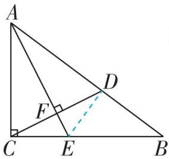
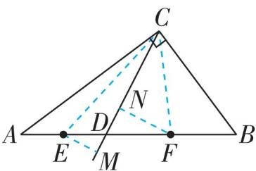

> [!success]- 必刷题
>
> > [!success] **【答案】** $\frac{5}{2}$
>
> > [!note]- **【解析】**
> > 连接 $DE$ , 如图. 因为 $AD = AC = 3, AE \perp CD$ , 所以 $AE$ 是 $CD$ 的垂直平分线, 所以 $CE = DE$ , 所以易得
> >
> > 
> >
> > 关键点拨
> > 本题主要考查了线段垂直平分线的判定和性质与勾股定理的综合应用,运用等面积法求出 DE 的长是解题的关键.
> >
> > $\triangle ACE \cong \triangle ADE$ ，所以 $\angle ADE = \angle ACB = 90^{\circ}$ 。在 Rt $\triangle ABC$ 中，由勾股定理得 $AB^{2} = AC^{2} + BC^{2} = 25$ ，所以 $AB = 5$ ，所以 $BD = AB - AD = 2$ 。因为 $S_{\triangle ABC} = S_{\triangle ACE} + S_{\triangle ABE}$ ，所以 $AC \times BC = AC \times CE + AB \times DE$ ，所以 $3 \times 4 = 3CE + 5DE$ ，所以 $DE = \frac{3}{2}$ 。在 Rt $\triangle BDE$ 中，由勾股定理得 $BE^{2} = DE^{2} + BD^{2} = \left(\frac{3}{2}\right)^{2} + 2^{2} = \frac{25}{4}$ ，所以 $BE = \frac{5}{2}$ 。故答案为 $\frac{5}{2}$ 。
> >
> > 5.7.5 【解析】如图, 连接 CE, CF, 过 E 作 CD 的垂线, 垂足为 M, 过 F 作 CD 的垂线, 垂足为
> >
> > 
> >
> > N, 即 EM = m, EN = n, 所以 $S_{\triangle CDF} = \frac{1}{2} CD \times n$ , $S_{\triangle CDE}=\frac{1}{2}CD\times m.$ 因为 E, F 分别为 AD, BD 的中点, 所以 $S_{\triangle CDE}=\frac{1}{2}S_{\triangle CDA}, S_{\triangle CDF}=\frac{1}{2}S_{\triangle CDB}$ , 所以 $S_{\triangle CEF}=S_{\triangle CDE}+S_{\triangle CDF}=\frac{1}{2}(S_{\triangle CDA}+S_{\triangle CDB})$ , 所以 $\frac{1}{2}CD(m+n)=\frac{1}{2}S_{\triangle ABC}.$ 因为 $\angle ACB=90^{\circ}$ , 所以 $S_{\triangle ABC}=\frac{1}{2}\times9\times12=54$ , 所以 $\frac{1}{2}CD(m+n)=27$ , 所以 $CD(m+n)=54$ , 所以当 CD 最短时, $m+n$ 有最大值, 此时 $CD \perp AB.$ 因为在 Rt $\triangle ABC$ 中, 由勾股定理得 $AB^{2}=12^{2}+9^{2}=$
> >
> > 关键点拨
> > 利用正方形面积公式,梯形面积公式和三角形面积公式,用两种不同的方式表示图形的面积是解题的关键.
> >
> > 225, 所以 $AB = 15$ . 设 $AB$ 边上的高为 $h$ , 所以 $\frac{1}{2} AB \cdot h = 54$ , 所以 $h = 7.2$ , 即 $CD = 7.2$ , 所以 $m + n = \frac{54}{7.2} = 7.5$ , 所以 $m + n$ 的最大值为 7.5. 故答案为 7.5.
