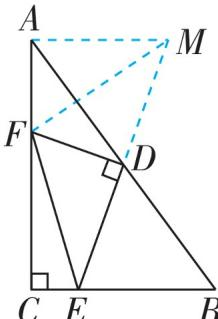

> [!success]- 必刷题
>
> > [!success] **【答案】** 详见解析
>
> > [!note]- **【解析】**
> > 【解】(1)延长 $ED$ 至 $M$ 使 $DM = DE$ , 连接 $AM$ ,
> >
> > $FM$ ，如图.因为 $D$ 为 $AB$ 中点，所以 $AD = BD$ .在 $\triangle ADM$ 与 $\triangle BDE$ 中， $\left\{ \begin{array}{l}AD = BD,\\ \angle ADM = \angle BDE,\\ DM = DE, \end{array} \right.$
> >
> > 
> >
> > 以 $\triangle ADM \cong \triangle BDE(SAS)$ , 所以 $AM = BE, \angle DAM = \angle B$ , 所以 $AM // BC$ , 所以 $\angle MAF = 180^\circ - \angle C = 90^\circ$ . 因为 $FD \perp ME, DE = DM$ , 所以 $MF = FE$ . 因为在 Rt $\triangle MAF$ 中, $AM^2 + AF^2 = MF^2$ , 所以 $AF^2 + BE^2 = EF^2$ .
> >
> > (2) $AF = \frac{17}{7}$ . 设 $AF = x$ . 因为 $AC = 7, BC = 5$ , $CE = 1$ , 所以 $CF = AC - AF = 7 - x, BE = BC - CE = 4$ . 因为 $\angle C = 90^\circ$ , 所以 $CF^2 + CE^2 = EF^2$ , 所以 $EF^2 = (7 - x)^2 + 1$ . 由 (1) 知 $MF = EF, \angle MAF = 90^\circ, AM = BE$ , 所以 $MF^2 = (7 - x)^2 + 1, AM = 4$ . 因为 $\angle MAF = 90^\circ$ , 所以 $AF^2 + AM^2 = MF^2$ , 所以 $x^2 + 4^2 = (7 - x)^2 + 1$ , 解得 $x = \frac{17}{7}$ , 所以 $AF = \frac{17}{7}$ .
