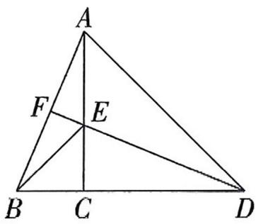

<!-- question-source:start -->
2[2025 河南郑州期中]为验证勾股定理,小明进行了如下的思考:如图,在 Rt△ABC 中,∠ACB=90°,在边 AC 上截取 CE=CB,延长 BC 到点 D,使得 CD=CA,连接 AD,DE,并延长 DE 交 AB 于点 F,已知 BC=a,AC=b,AB=c.

(1)在验证之前小明发现 $AB$ 和 $DE$ 存在着一定的数量关系和位置关系,猜想 $AB$ 和 $DE$ 的数量关系和位置关系,并说明理由;

(2)通过以上条件验证勾股定理.

<!-- question-source:end -->

![[Q00105085A1]]
