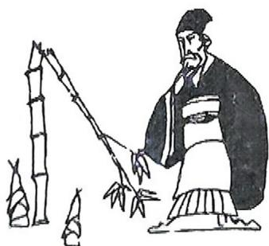

<!-- question-source:start -->
3 新考向传统文化 在《九章算术》中有一个问题(如图): 今有竹高一丈,末折抵地,去本三尺,问折者高几何?

意思是有一根竹子原高1丈(1丈=10尺),中间有一处折断,竹梢触地面处离竹根3尺(1尺= $\frac{1}{3}$ 米),试问折断处离地面() A.4尺 B.3.6尺 C.4.5尺 D.4.55尺
<!-- question-source:end -->

![[Q00105086A1]]
