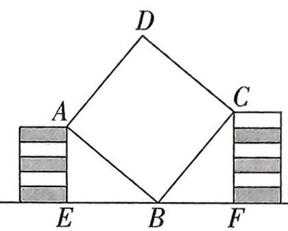
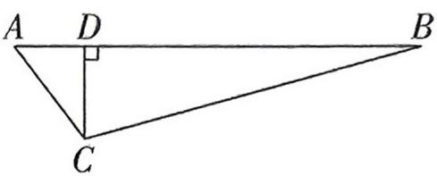

<!-- question-source:start -->
5 小亮用 11 块高度都是 $2 \mathrm{~cm}$ 的相同长方体小木块垒了两堵与地面垂直的木墙, 木墙之间刚好可以放进一个正方形木板 $ABCD$ , 截面如图所示. 两木墙的高度分别为 $AE$ 与 $CF$ 的长, 点 $B$ 在 $EF$ 上, 则正方形木板 $ABCD$ 的面积为 $\mathrm{cm}^{2}$ .

(第 5 题图)

(第6题图)

[2025 江苏徐州期中]如图,在笔直的公路 $AB$ 旁有一个城市书房 $C, C$ 到公路 $AB$ 的距离 $CD$ 为 80 米, $AC$ 为 100 米, $BC$ 为 300 米. 一辆公交车以 10 米/秒的速度从 $A$ 处出发,沿公路 $AB$ 向 $B$ 处行驶. 若公交车鸣笛声会使以公交车为中心 170 米范围内受到噪音影响,则公交车在公路 $AB$ 上行驶时,至少\_\_\_\_秒不鸣笛才能使在城市书房 $C$ 中看书的读者不受噪音影响.

<!-- question-source:end -->

![[Q00105088A1]]
