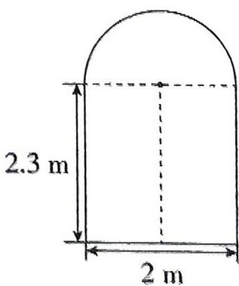

<!-- question-source:start -->
7 一辆装满货物的卡车, 高 $2.5 \mathrm{~m}$ , 宽 $1.6 \mathrm{~m}$ , 要开进上边是半圆, 下边是长方形的隧道, 如图所示, 已知半圆的直径为 $2 \mathrm{~m}$ , 长方形的另一条边长是 $2.3 \mathrm{~m}$ .

(1) 此卡车是否能通过隧道？试说明你的理由。

(2)为了适应车流量的增加,现把隧道改为双行道,要使宽为1.2 m,高为2.8 m的卡车能安全通过,那么此隧道的宽至少增加到多少?

公众号\*满满分享库

电子错题本鸭
<!-- question-source:end -->

![[Q00105089A1]]
