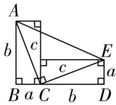

> [!success]- 必刷题
>
> > [!success] **【答案】** D
>
> > [!note]- **【解析】**
> > - **①**：题图中大正方形的面积为 $c^{2}$ , 四个直角三角形的面积和为 $4 \times \frac{1}{2} ab = 2ab$ , 中间小正方形的边长为 $(b - a)$ . 由大正方形的面积可以表示为四个直角三角形的面积与中间小正方形的面积之和, 得 $(b - a)^{2} + 4 \times \frac{1}{2} ab = a^{2} +$ $b^{2}=c^{2}$ ，所以①能验证勾股定理。
> > - **②**：如图，四边形ACDE的面积为直角梯形ABDE的面积减去直角三角形ABC的面积，即 $\frac{(a+b)(a+b)}{2}-\frac{1}{2}ab=\frac{1}{2}a^{2}+\frac{1}{2}b^{2}+\frac{1}{2}ab$ ，四边形ACDE的面积还可以表示为等腰直角三角形ACE的面积加上直角三角形CDE的面积，即 $\frac{1}{2}c^{2}+\frac{1}{2}ab$ ，所以 $\frac{1}{2}a^{2}+\frac{1}{2}b^{2}+\frac{1}{2}ab=\frac{1}{2}c^{2}+\frac{1}{2}ab$ ，即 $a^{2}+b^{2}=c^{2}$ ，所以②能验证勾股定理。
> > - **③**：题图中大正方形的面积为 $(a+b)^{2}=a^{2}+b^{2}+2ab$ ，大正方形的面积还可以表示为四个直角三角形的面积加上中间小正方形的面积，即 $4\times\frac{1}{2}ab+c^{2}=2ab+c^{2}$ ，所以 $a^{2}+b^{2}+2ab=2ab+c^{2}$ ，即 $a^{2}+b^{2}=c^{2}$ ，所以③能验证勾股定理。
> > - **④**：题图中五边形的面积为大正方形的面积加上两个直角三角形的面积，即 $c^{2}+2\times\frac{1}{2}ab=c^{2}+ab$ ，五边形的面积还可以表示为两个小正方形的面积加上两个直角三角形的面积，即 $a^{2}+b^{2}+2\times\frac{1}{2}ab=a^{2}+b^{2}+ab$ ，所以 $c^{2}+ab=a^{2}+b^{2}+ab$ ，即 $a^{2}+b^{2}=c^{2}$ ，所以④能验证勾股定理。故选D.
> >
> > 关键点拨
> > 解决本题的关键是根据题意得到 $\angle ABC = 90^{\circ}$ .
> >
> > 
