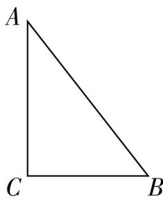

> [!success]- 必刷题
>
> > [!success] **【答案】** D
>
> > [!note]- **【解析】**
> > 如图, 由题意得 $\angle ACB = 90^{\circ}, BC = 3$ 尺, $AC + AB = 10$ 尺. 设折断处离地面 $x$ 尺, 则 $AB = (10 - x)$ 尺. 在 Rt $\triangle ABC$ 中, 由勾股定理得 $x^{2} + 3^{2} = (10 - x)^{2}$ , 解得 $x = 4.55$ , 面 4.55 尺. 故选 D.
> >
> > 
