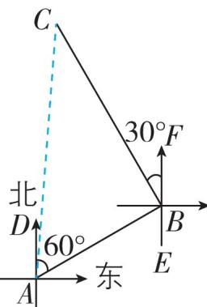

> [!success]- 必刷题
>
> > [!success] **【答案】** 50
>
> > [!note]- **【解析】**
> > 如图, 连接 AC.
> > 由题意得 $\angle DAB = 60^{\circ}$ , $\angle FBC = 30^{\circ}, AD \parallel EF$ ，所以 $\angle DAB = \angle ABE = 60^{\circ}$ ，所以 $ABC = 180^{\circ} - \angle ABE - FBC = 90^{\circ}$ . 在 Rt△ABC 中，
> >
> > 
> >
> > $AB = 30 \mathrm{~km}, BC = 40 \mathrm{~km}, AC^{2} = AB^{2} + BC^{2} = 30^{2} + 40^{2} = 2500$ ，所以 $AC = 50 \mathrm{~km}$ ，所以 $A, C$ 两港之间的距离为 $50 \mathrm{~km}$ ，故答案为 50.
