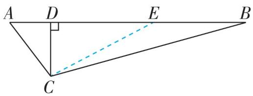
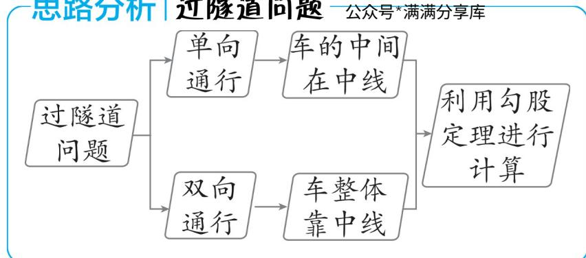
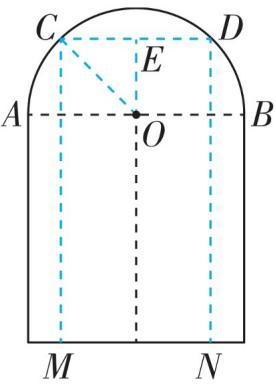
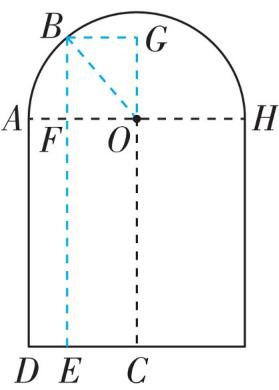

> [!success]- 必刷题
>
> > [!success] **【答案】** 21
>
> > [!note]- **【解析】**
> > 在正方形木板 ABCD 中, $\angle ABC = 90^{\circ}$ , AB = BC. 因为 $AE \perp EF$ , $CF \perp EF$ , 所以 $\angle AEB = \angle BFC = 90^{\circ}$ , 所以 $\angle EAB + \angle ABE = 90^{\circ}$ . 因为 $\angle ABC = 90^{\circ}$ , 所以 $\angle ABE + \angle CBF = 90^{\circ}$ , 所以 $\angle EAB = \angle CBF$ . 在 $\triangle ABE$ 和 $\triangle BCF$ 中, $\left\{\begin{aligned}\angle EAB &= \angle CBF, \\ \angle AEB &= \angle BFC=90^{\circ}, \\ AB &= BC,\end{aligned}\right.$ $\triangle BCF(AAS)$ ，所以 $AE = BF = 2 \times 5 = 10(cm)$ .
> > 因为 $CF = 2 \times 6 = 12(cm)$ ，所以在 Rt $\triangle BCF$ 中， $BC^{2} = BF^{2} + CF^{2} = 10^{2} + 12^{2} = 244$ ，所以 $S_{正方形ABCD}=BC^{2}=244~cm^{2}$ ，即正方形木板 ABCD
> > 的面积为 $244~cm^{2}$ .
> >
> > 6.21 【解析】如图,在 $BD$ 上取一点 $E$ ,连接 $CE$ ,使 $CE = 170$ 米.因为 $\angle CDE = 90^{\circ}, CD = 80$ 米,所以 $DE^{2} = CE^{2} - CD^{2} = 170^{2} - 80^{2} = 22500$ ,所以 $DE = 150$ 米.因为 $CD = 80$ 米, $AC = 100$ 米<170米,所以公交车在 $EA$ 段不能鸣笛, $AD^{2} = AC^{2}-CD^{2} = 100^{2} - 80^{2} = 3600$ ,所以 $AD = 60$ 米,所以 $EA = AD + DE = 60 + 150 = 210$ (米).因为 $\frac{210}{10} = 21$ (秒),所以公交车在公路 $AB$ 上行驶时,至少 21 秒不鸣笛才能使在城市书房 C 中看书的读者不受噪音影响. 故答案为 21.
> >
> > 
> >
> > 
> >
> > 【解】(1)该卡车能通过隧道. 理由如下:如图(1),MN为卡车的宽度,分别过M,N作AB的垂线交半圆于C,D,连接CD,过AB的中点O作OE⊥CD,E为垂足,连接OC. 易知CD=MN=1.6m,AB=2m,所以由对称可得CE=DE=0.8m,OC=OA=1m. 在Rt△OCE中, $OE^{2}=OC^{2}-CE^{2}=0.36$ ,即OE=0.6m,所以CM=2.3+0.6=2.9(m)>2.5m,所以这辆卡车能通过隧道.
> >
> > 
> > 图(1)
> >
> > 
> > 图(2)
> >
> > 关键点拨勾股数的判定是勾股定理中常考题目, 注意满足勾股定理的同时, 也必须为正整数.
> >
> > (2)如图(2), $EC$ 为卡车的宽度, 过 $E$ 作 $AH$ 的垂线交半圆于 $B$ , 垂足为 $F$ , 连接 $OB$ , 过 $B$ 作 $BG \perp CO$ , 交 $CO$ 的延长线于 $G$ . 根据题意可知 $CG = BE = 2.8 \mathrm{~m}, BG = OF = EC = 1.2 \mathrm{~m}, EF = AD = 2.3 \mathrm{~m}$ , 所以 $BF = 2.8 - 2.3 = 0.5(\mathrm{~m})$ . 根据勾股定理得 $OA^2 = OB^2 = BF^2 + OF^2 = 0.5^2 + 1.2^2 = 1.69$ , 即 $OA = 1.3 \mathrm{~m}$ , 所以隧道的宽至少增加到 $1.3 \times 2 = 2.6(\mathrm{~m})$ .
> >
> > ## 2 一定是直角三角形吗
