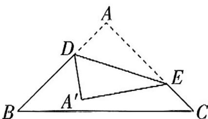

<!-- question-source:start -->
3 [2025 重庆大渡口区校级期中, 中] 如图, $\triangle ABC$ 为等腰直角三角形, $AB = AC = 4$ , $\angle A = 90^{\circ}$ , 点 $E$ 为 $AC$ 上一点, 且 $CE = 1$ , 点 $D$ 为 $AB$ 上一点, 连接 $DE$ , 将 $\triangle ABC$ 沿 $DE$ 折叠, 使点 $A$ 落在点 $A'$ 处, 若 $EA'$ 的延长线恰好经过点 $B$ , 则 $AD = \_$ .

<!-- question-source:end -->

![[Q00105120A1]]
