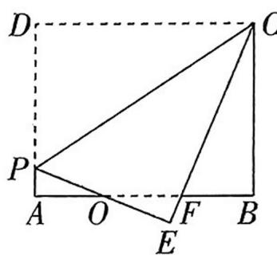

<!-- question-source:start -->
6[2025 浙江宁波期中, 中]如图, 长方形纸片 $ABCD, AB = 10, AD = 8$ , 点 $P$ 在 $AD$ 边上, 将 $\triangle CDP$ 沿 $CP$ 折叠, 点 $D$ 落在 $E$ 处, $PE, CE$ 分别交 $AB$ 于

点 O, F，且 OP = OF，则 BF 的长为 \_\_\_\_.
<!-- question-source:end -->

![[Q00105123A1]]
