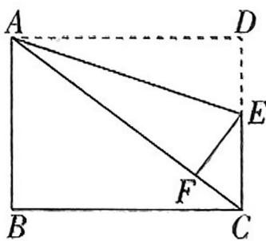

<!-- question-source:start -->
7 [2025 江苏苏州质检, 中] 如图, 长方形 $ABCD$ 中, $AB = 6$ , $AD = 8$ , 点 $E$ 是 $CD$ 边上一点, 把 $\triangle ADE$ 沿直线 $AE$ 折叠, 点 $D$ 恰好落在 $AC$ 上的点 $F$ 处.

(1) 求 $AC$ 的长.

(2)求 $DE$ 的长.

电子错题本鸭
<!-- question-source:end -->

![[Q00105124A1]]
