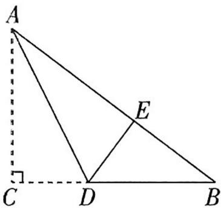
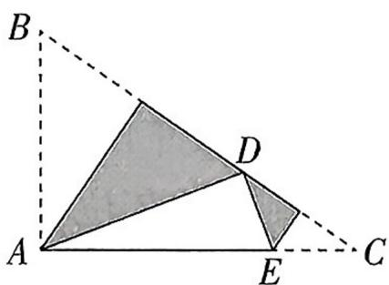

<!-- question-source:start -->
1. [2025 广东佛山质检, 中] 如图, 有一个直角三角形纸片 $ABC$ , $\angle C = 90^{\circ}$ , $AC = 6 \mathrm{~cm}$ , $BC = 8 \mathrm{~cm}$ . 现将直角边 $AC$ 沿直线 $AD$ 折叠, 使点 $C$ 落在斜边 $AB$ 上的点 $E$ 处, 则 $CD$ 的长为 ( ) A. $5 \mathrm{~cm}$ B. $4 \mathrm{~cm}$ C. $3 \mathrm{~cm}$ D. $2 \mathrm{~cm}$

(第1题图)

(第2题图)
<!-- question-source:end -->

![[Q00106329A1]]
