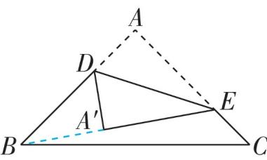

> [!success]- 必刷题
>
> > [!success] **【答案】** $\frac{3}{2}$
>
> > [!note]- **【解析】**
> > 如图. 因为 $CE = 1$ , 所以 $AE = AC - CE = 3$ . 因为 $\angle A =$
> >
> > 
> >
> > $90^{\circ}$ , 所以在 Rt $\triangle ABE$ 中, $BE^{2} = AB^{2} + AE^{2} = 25$ , 所以 $BE = 5$ . 设 $AD = x$ , 由折叠的性质, 得 $\angle DA'E = \angle A = 90^{\circ}, A'D = AD = x, A'E = AE = 3$ ,初中必刷题 数学八年级上册 BS 公众号\*满满分享库
> > 所以 $BA' = BE - A'E = 2, BD = AB - AD = 4 - x.$ 在 Rt△A'DB 中，由勾股定理得 $BD^{2} = BA'^{2} + DA'^{2}$ ，所以 $2^{2} + x^{2} = (4 - x)^{2}$ ，解得 $x = \frac{3}{2}$ ，所以 $AD = \frac{3}{2}$ 。故答案为 $\frac{3}{2}$ 。
