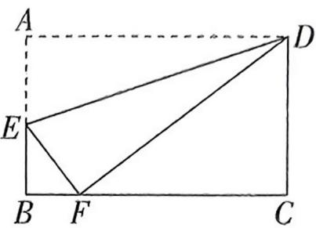
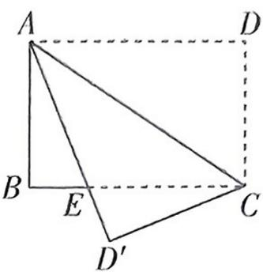

## 重难专题 1 利用勾股定理解决折叠问题

## 类型 1 与三角形有关的折叠

![[初中/课堂同步/教辅/必刷题/2026 八上必刷题 北师大数学/01_第一章_勾股定理/重难专题_1_利用勾股定理解决折叠问题/questions/Q00106329.md]]
![[初中/课堂同步/教辅/必刷题/2026 八上必刷题 北师大数学/01_第一章_勾股定理/重难专题_1_利用勾股定理解决折叠问题/questions/Q00105119.md]]
![[初中/课堂同步/教辅/必刷题/2026 八上必刷题 北师大数学/01_第一章_勾股定理/重难专题_1_利用勾股定理解决折叠问题/questions/Q00105120.md]]

## 类型 2 与四边形有关的折叠

![[初中/课堂同步/教辅/必刷题/2026 八上必刷题 北师大数学/01_第一章_勾股定理/重难专题_1_利用勾股定理解决折叠问题/questions/Q00105121.md]]

## 建议用时 30 分钟 答案 D7

(第4题图)

(第5题图)

![[初中/课堂同步/教辅/必刷题/2026 八上必刷题 北师大数学/01_第一章_勾股定理/重难专题_1_利用勾股定理解决折叠问题/questions/Q00105122.md]]
![[初中/课堂同步/教辅/必刷题/2026 八上必刷题 北师大数学/01_第一章_勾股定理/重难专题_1_利用勾股定理解决折叠问题/questions/Q00105123.md]]
![[初中/课堂同步/教辅/必刷题/2026 八上必刷题 北师大数学/01_第一章_勾股定理/重难专题_1_利用勾股定理解决折叠问题/questions/Q00105124.md]]
