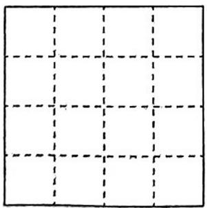
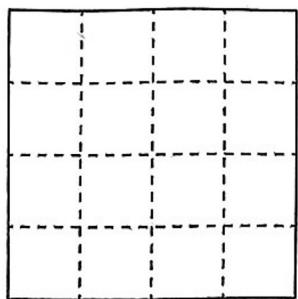

<!-- question-source:start -->
4 如图, 在 $4 \times 4$ 的正方形网格中, 每个小正方形的边长都为 1 , 每个小正方形的顶点叫作格点, 以格点为顶点分别按下列要求画三角形.

图(1)

图(2)

(1) 在图(1)中, 画一个直角三角形, 使它的三边长都是有理数;

(2) 在图(2)中, 画一个直角三角形, 使它的三边长都是无理数.
<!-- question-source:end -->

![[Q00105140A1]]
