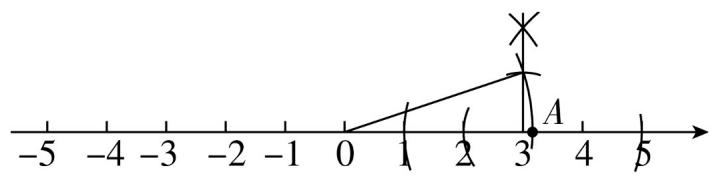

> [!success]- 必刷题
>
> > [!success] **【答案】** 详见解析
>
> > [!note]- **【解析】**
> > 【解】如图,点 A 即为所求.
> >
> > 
> >
> > ## 2 平方根与立方根
> >
> > ## 课时1 算术平方根
> >
> > 易错警示
> > 此类题易将 $\sqrt{a}(a \geqslant 0)$ 的算术平方根误认为是 a 的算术平方根, 从而导致错误.
