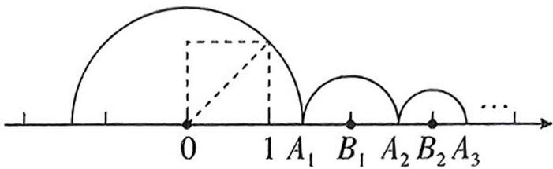

<!-- question-source:start -->
7[2025 浙江温州期末]如图,通过画边长为1的正方形,就能准确地把 $\sqrt{2}$ 表示在数轴上的点 $A_{1}$ 处,记 $A_{1}$ 右侧最近的整数点为 $B_{1}$ ,以点 $B_{1}$ 为圆心, $A_{1}B_{1}$ 为半径画半圆,交数轴于点 $A_{2}$ ,记 $A_{2}$ 右侧最近的整数点为 $B_{2}$ , 以点 $B_{2}$ 为圆心, $A_{2}B_{2}$ 为半径画半圆, 交数轴于点 $A_{3}$ , 如此继续, 则 $A_{8}B_{8}$ 的长为 ( )

A. $\sqrt{2} - 1$ B. $\sqrt{2}$ C. $\sqrt{2} + 1$ D. $2 - \sqrt{2}$
<!-- question-source:end -->

![[Q00105835A1]]
