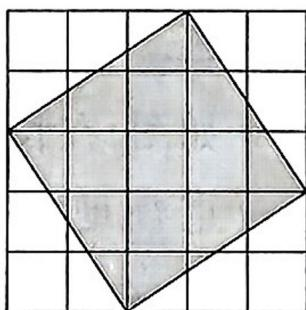

<!-- question-source:start -->
15 如图,每个小正方形的边长均为 1. (1) 图中阴影部分的面积是 ,阴影部分正方形的边长 $a$ 是 . (2) 估计边长 $a$ 的值在两个相邻整数与之间. (3) 我们知道 $\pi$ 是无理数,而无理数是无限不循环小数,因此 $\pi$ 的小数部分我们不可能全部写出来,我们可以用 3 来表示它的整数部分,用 $\pi - 3$ 表示它的小数部分. 设边长 $a$ 的整数部分为 $x$ ,小数部分为 $y$ ,求 $x - y$ 的相反数.

<!-- question-source:end -->

![[Q00105843A1]]
