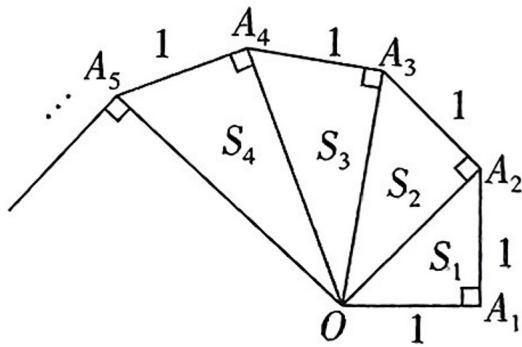
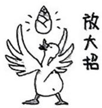

<!-- question-source:start -->
17[2025 山东青岛质检]观察图形,认真分析下列各式,然后解答问题: $OA_{1}=1;$ $OA_{2}=\sqrt{1^{2}+1^{2}}=\sqrt{2};S_{1}=\frac{1}{2}\times1\times1=\frac{1}{2};$ $OA_{3}=\sqrt{2+1^{2}}=\sqrt{3};S_{2}=\frac{1}{2}\times\sqrt{2}\times1=\frac{\sqrt{2}}{2};$ $OA_{4}=\sqrt{3+1^{2}}=\sqrt{4};S_{3}=\frac{1}{2}\times\sqrt{3}\times1=\frac{\sqrt{3}}{2}.$ (1) 推算出 $OA_{5}=$ \_\_\_\_.
(2) 若 n 是正整数，则 $S_{n}=$ \_\_\_\_.
(3) 若一个三角形的面积是 3，则它是第几个三角形？

(4) 求出 $s_{1}^{2} + s_{2}^{2} + s_{3}^{2} + \cdots + s_{100}^{2}$ 的值.

电子错题本鸭
<!-- question-source:end -->

![[Q00105845A1]]
