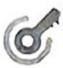

## 全章综合训练 刷中考

## 刷中考

## 考点1 实数

![[初中/课堂同步/教辅/必刷题/2026 八上必刷题 北师大数学/02_第二章/全章综合训练/questions/Q00105812.md]]

## 考点 2 平方根和立方根

![[初中/课堂同步/教辅/必刷题/2026 八上必刷题 北师大数学/02_第二章/全章综合训练/questions/Q00105813.md]]
![[初中/课堂同步/教辅/必刷题/2026 八上必刷题 北师大数学/02_第二章/全章综合训练/questions/Q00105814.md]]
![[初中/课堂同步/教辅/必刷题/2026 八上必刷题 北师大数学/02_第二章/全章综合训练/questions/Q00105815.md]]
![[初中/课堂同步/教辅/必刷题/2026 八上必刷题 北师大数学/02_第二章/全章综合训练/questions/Q00105816.md]]
![[初中/课堂同步/教辅/必刷题/2026 八上必刷题 北师大数学/02_第二章/全章综合训练/questions/Q00105817.md]]
![[初中/课堂同步/教辅/必刷题/2026 八上必刷题 北师大数学/02_第二章/全章综合训练/questions/Q00105818.md]]
![[初中/课堂同步/教辅/必刷题/2026 八上必刷题 北师大数学/02_第二章/全章综合训练/questions/Q00105819.md]]
![[初中/课堂同步/教辅/必刷题/2026 八上必刷题 北师大数学/02_第二章/全章综合训练/questions/Q00105820.md]]
![[初中/课堂同步/教辅/必刷题/2026 八上必刷题 北师大数学/02_第二章/全章综合训练/questions/Q00105821.md]]
![[初中/课堂同步/教辅/必刷题/2026 八上必刷题 北师大数学/02_第二章/全章综合训练/questions/Q00105822.md]]

## 考点3 二次根式

![[初中/课堂同步/教辅/必刷题/2026 八上必刷题 北师大数学/02_第二章/全章综合训练/questions/Q00105823.md]]
![[初中/课堂同步/教辅/必刷题/2026 八上必刷题 北师大数学/02_第二章/全章综合训练/questions/Q00105824.md]]
![[初中/课堂同步/教辅/必刷题/2026 八上必刷题 北师大数学/02_第二章/全章综合训练/questions/Q00105825.md]]
![[初中/课堂同步/教辅/必刷题/2026 八上必刷题 北师大数学/02_第二章/全章综合训练/questions/Q00105826.md]]
![[初中/课堂同步/教辅/必刷题/2026 八上必刷题 北师大数学/02_第二章/全章综合训练/questions/Q00105827.md]]
![[初中/课堂同步/教辅/必刷题/2026 八上必刷题 北师大数学/02_第二章/全章综合训练/questions/Q00105828.md]]
![[初中/课堂同步/教辅/必刷题/2026 八上必刷题 北师大数学/02_第二章/全章综合训练/questions/Q00105829.md]]
