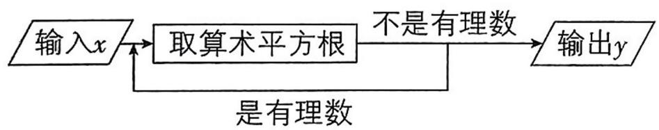

<!-- question-source:start -->
3[2025 浙江杭州期中]如图是一个数值转换器, 当输入的 $x$ 的值为 81 时, 输出的 $y$ 的值是 ( )
输入 $x$ 取算术平方根 不是有理数 输出 $y$ 是有理数
A. $\sqrt{3}$ B. 9 C. 3 D. $-\sqrt{3}$

<!-- question-source:end -->

![[Q00106334A1]]
