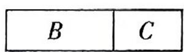
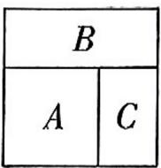

<!-- question-source:start -->
5[2025 青海西宁期末,较难]将图(1)中的长方形分成 $B, C$ 两部分,恰与正方形 $A$ 拼接成如图(2)的大正方形. 如果正方形 $A$ 的面积为 2 , 拼接后的大正方形的面积是 5 , 则图(1)中原长方形的长是

图(1)
图(2)

你既还怪好的嘞
<!-- question-source:end -->

![[Q00105230A1]]
