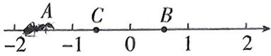

<!-- question-source:start -->
7[2025 山西吕梁期中, 中]如图, 一只蚂蚁从点 $A$ 沿数轴向右爬 2 个单位长度到达点 $B$ , 点 $C$ 与点 $B$ 关于原点对称, 若 $A, B, C$ 三点对应的数分别为 $a, b, c, a = -\sqrt{2}$ . (1) 填空: $b = \_ \_, c = \_ \_, bc + 6 = \_ \_;$

(2)化简: $\sqrt{(a-1)^{2}}+\sqrt{(b-1)^{2}}+\sqrt{(c-1)^{2}}$ .

<!-- question-source:end -->

![[Q00105232A1]]
