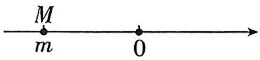

<!-- question-source:start -->
3. [2025 山东枣庄质检, 中]如图, 实数 m 在数轴上对应的点 M 到原点的距离为 5. 下列各数所对应的点中, 与点 M 最接近的是 ( )

A. $-4\sqrt{2}$ B. $-3\sqrt{2}$ C. $-2\sqrt{2}$ D. $-\sqrt{2}$

<!-- question-source:end -->

![[Q00106422A1]]
