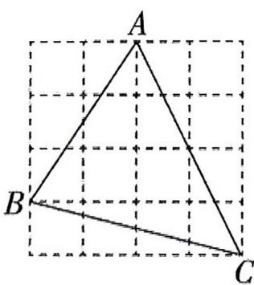

<!-- question-source:start -->
6[2025 重庆渝中区校级期末]如图, 将 $\triangle ABC$ 放在正方形网格图中(图中每个小正方形的边长均为1), 点 $A, B, C$ 恰好在格点(小正方形的顶点)

上,则△ABC中BC边上的高的长度是( )
A. $\frac{7\sqrt{5}}{10}$ B. $\frac{7\sqrt{13}}{13}$ C. $\frac{7\sqrt{17}}{17}$ D. $\frac{14\sqrt{17}}{17}$
<!-- question-source:end -->

![[Q00105239A1]]
