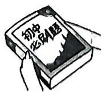

<!-- question-source:start -->
4[2025 河北邯郸调研, 中] 幻方是一种传统游戏, 类比幻方, 我们给出如图所示的方格, 要使方格中横向、纵向及对角线方向上的实数相乘的结果都相等, 则 $(A + B) \cdot D + C$ 的值为 \_\_\_\_.

<table><tr><td>A</td><td>B</td><td>5√2</td></tr><tr><td>5</td><td>√10</td><td>C</td></tr><tr><td>√2</td><td>10</td><td>D</td></tr></table>

公主王子请刷题鹏
<!-- question-source:end -->

![[Q00105249A1]]
