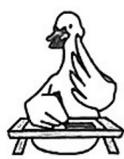

<!-- question-source:start -->
1 [2025 四川成都期中]下列说法中,正确的是
( )
A. 27 的立方根是 3 ,记作 $\sqrt{27} = 3$ B. -25 的算术平方根是 5
C. a 的三次方根是 $\pm \sqrt[3]{a}$ D. 0 的立方根是 0

<!-- question-source:end -->

![[Q00105177A1]]
