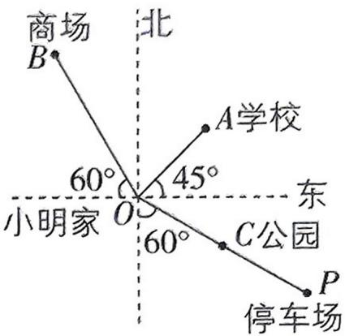

<!-- question-source:start -->
5[2024 河北邢台质检]如图是小明家和学校所在地的简单地图,已知 $OA = 2 \mathrm{~km}, OB = 3.5 \mathrm{~km}$ , $OP = 4 \mathrm{~km}$ , 点 $C$ 为 $OP$ 的中点, 回答下列问题: (1) 图中到小明家距离相同的是哪些地方? (2) 由图可知, 公园在小明家南偏东 $60^{\circ}$ 方向 $2 \mathrm{~km}$ 处. 请用方位角与距离分别描述学校、商

建议用时 20 分钟 答案 D23

场、停车场相对于小明家的位置.

<!-- question-source:end -->

![[Q00105849A1]]
