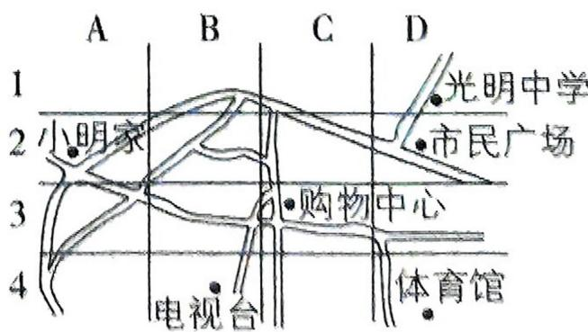

<!-- question-source:start -->
7[2024 四川成都金牛区质检]如图是某市地图的一部分,根据该图回答问题.
(1)若小明家位于A2区,则光明中学、市民广场、购物中心、电视台、体育馆分别位于哪个区域?
(2)某路公交车从小明家门口的车站出发,途经A2区、A3区、B2区、B1区、C1区、C2区、D2区、D1区,到达光明中学,请你在图中描出它的行车路线.

<!-- question-source:end -->

![[Q00105851A1]]
