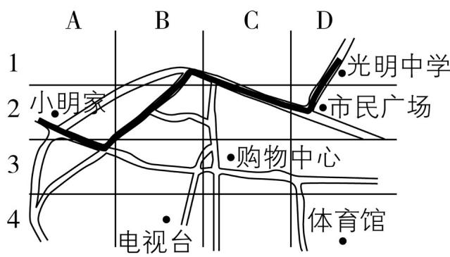

> [!success]- 必刷题
>
> > [!success] **【答案】** A
>
> > [!note]- **【解析】**
> > 在平面内, 确定一个物体的位置一般需要两个数据,对各选项分析判断后,可知 A 选项正确. 故选 A.
> >
> > 解】(1)光明中学位于D1区,市民广场位于D2区,购物中心位于C3区,电视台位于B4区,体育馆位于D4区.
> >
> > (2)如图所示,图中黑粗线即为所求.
> >
> > 
