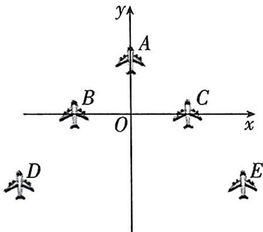
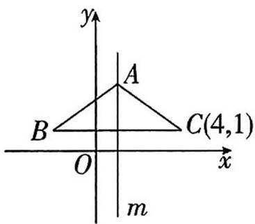

<!-- question-source:start -->
1 [2025 北京朝阳区校级期中]如图,飞机在空中展示的队形是轴对称图形,以飞机 B,C 所在直线为 x 轴、队形的对称轴为 y 轴,建立平面直角坐标系.若飞机 E 的坐标为 $(50,m)$ ,则飞机 D 的坐标为
( )
A. $(-50,m)$ B. $(50,-m)$ C. $(-50,-m)$ D. $(m,-50)$

(第1题图)

(第2题图)
<!-- question-source:end -->

![[Q00105888A1]]
