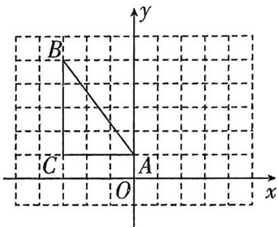

<!-- question-source:start -->
5 已知在 Rt△ABC 中, ∠C=90°, AC=3, BC=4, 在如图的平面直角坐标系中, 点 A 的坐标为 (0,1), 点 B 的坐标为 (-3,5), AC 与 x 轴平行.

建议用时 20 分钟 答案 D27

(1) 求点 C 的坐标;

(2)在如图的平面直角坐标系中作出 $\triangle ABC$ 关于 $y$ 轴对称的 $\triangle A_{1}B_{1}C_{1}$ , 并在图中标出 $B_{1}, C_{1}$ 两点的坐标;

(3) 若 $\triangle A_{2}B_{2}C_{2}$ 与 $\triangle ABC$ 关于 $x$ 轴对称, 求 $\triangle A_{2}B_{2}C_{2}$ 各顶点的坐标.

<!-- question-source:end -->

![[Q00105892A1]]
