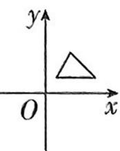

<!-- question-source:start -->
2[较难]如图,在平面直角坐标系中,对 $\triangle ABC$ 进行循环往复的轴对称变换,若原来点A坐标是(1,2),则经过第2021次变换后点A的对应点的坐标为()

第1次 第2次 第3次 第4次 关于y轴对称 关于x轴对称 关于y轴对称 关于x轴对称
A. (1, -2) B. (-1, -2)
C. (-1, 2) D. (1, 2)
<!-- question-source:end -->

![[Q00105896A1]]
