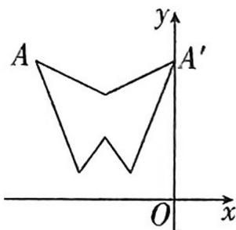

<!-- question-source:start -->
3[2024 吉林松原质检, 中]如图, 在平面直角坐标系中摆放着一个轴对称图形, 其中点 $A(-6, 6)$ 的对称点 $A'$ 坐标为

(0,6), 点 $M(m, n)$ 为图形上的一点, 则点 $M$ 在图形上的对称点坐标为 \_\_\_\_.
<!-- question-source:end -->

![[Q00105897A1]]
