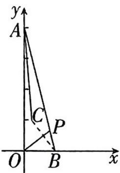

<!-- question-source:start -->
4[2024 河南许昌质检, 中]如图, 已知平面直角坐标系中的两点 $A(0,4), B(1,0), P$ 为线段 $AB$ 上一动点 (不与点 $A, B$ 重合), 作点 $B$ 关于射线 $OP$ 的对称点 $C$ , 则线段 $AC$ 长度的取值范围是

<!-- question-source:end -->

![[Q00105898A1]]
