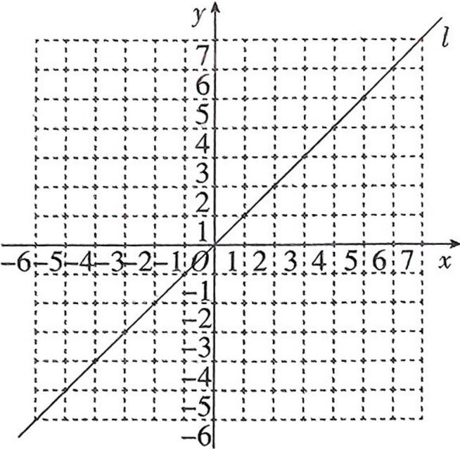

<!-- question-source:start -->
5[2025 黑龙江哈尔滨质检, 中]如图, 在平面直角坐标系中, 直线 $l$ 为第一、三象限的角平分线. 点 $P$ 关于 $y$ 轴的对称点为 $P$ 的一次反射点, 记为 $P_{1}$ , 点 $P_{1}$ 关于直线 $l$ 的对称点称为点 $P$ 的二次反射点, 记为 $P_{2}$ . 例如, 点 $(-1, 2)$ 的一次反射点为 $(1, 2)$ , 二次反射点为 $(2, 1)$ . 根据定义, 回答下列问题: (1) 点 $(3, -4)$ 的一次反射点为 \_\_\_\_, 二次反射点为 \_\_\_\_; (2) 若 $P(m + 1, 2n - 1)$ 的一次反射点和 $Q(-3,$

4)的二次反射点重合,求 $m+n$ 的值.

<!-- question-source:end -->

![[Q00105899A1]]
