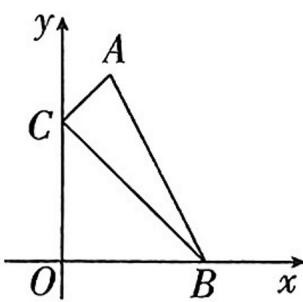

<!-- question-source:start -->
6[2024 广东佛山顺德区期中, 中]如图, 在平面直角坐标系中, 点 $A, B$ 的坐标分别为 (2,8) 和 (6,0), $C$ 是 $y$ 轴上的一个动点, 且 $A, B, C$ 三点不在同一条直线上. (1) 求 $AB$ 的长; (2) 求 $\triangle ABC$ 的周长的最小值.

<!-- question-source:end -->

![[Q00105900A1]]
