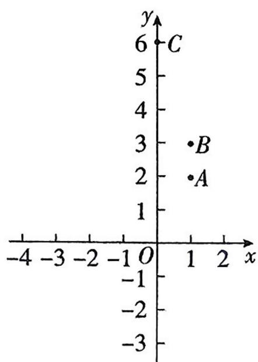

<!-- question-source:start -->
7 核心素养 几何直观 [难] 已知三点 $A(1,2), B(1,3), C(0,6)$ , 点 $P$ 为 $y$ 轴上一动点.

(1)在图中找到点 $P$ , 使得 $\triangle OAP$ 与 $\triangle CBP$ 周长的和取得最小值, 此时点 $P$ 的坐标应为\_\_\_\_; (2) 当 $\angle APB = 40^{\circ}$ 时, $\angle OAP + \angle PBC$ 的度数为\_\_\_\_.

<!-- question-source:end -->

![[Q00105901A1]]
