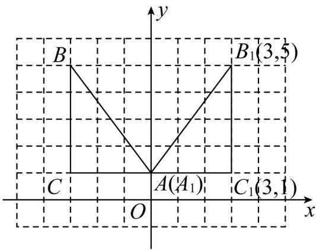

> [!success]- 必刷题
>
> > [!success] **【答案】** 详见解析
>
> > [!note]- **【解析】**
> > 【解】(1)由题图可知,点 C 的坐标为 $(-3,1)$ .
> > (2)如图所示, $\triangle A_{1}B_{1}C_{1}$ 即为所作.
> >
> > 
> >
> > 关键点拨
> > (2) ② OA 与 AB 的长度大小关系不确定, 需要分类讨论, 这是解决此题的突破口.
> >
> > (3) $A_{2}(0, - 1),B_{2}(-3, - 5),C_{2}(-3, - 1).$
