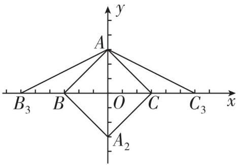

> [!success]- 必刷题
>
> > [!success] **【答案】** 详见解析
>
> > [!note]- **【解析】**
> > 【解】(1)以 BC 边中点 O 为原点, BC 边所在的直线为 x 轴, BC 边的垂直平分线为 y 轴, 建立平面直角坐标系, 如图. 易知 $\triangle ABO$ 和 $\triangle AOC$ 是等腰直角三角形, 所以 AO = BO = CO = 3, 所以 A(0,3), B(-3,0), C(3,0). (建系方法不唯一, 对应答案不唯一)
> >
> > (2)与原图形关于 x 轴对称, 如图中的 $\triangle A_{2}BC$ .
> >
> > (3)与原图形相比, 所得的图形横向拉长为原来的 2 倍, 如图中的 $\triangle AB_{3}C_{3}$ .
> >
> > 
