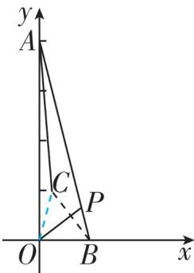

> [!success]- 必刷题
>
> > [!success] **【答案】** $3 \leqslant AC < \sqrt{17}$
>
> > [!note]- **【解析】**
> > 如图, 连接 $OC$ . 因为 $A(0,4), B(1,0)$ , 所以 $OA = 4, OB = 1$ , 所以
> >
> > $AB=\sqrt{OA^{2}+OB^{2}}=\sqrt{17}$ . 因为 C 是点 B 关于射线 OP 的对称点, 所以 OC=OB=1. 因为 $OA-OC\leqslant AC$ , 所以 $AC\geqslant3$ . 因为 P 为线段 AB 上一动点 (不与点 A,B 重合), 所以线段 AC
> >
> > 
> >
> > 与点 $A, B$ 重合), 所以线段 $AC$ 长度的取值范围是 $3 \leqslant AC < \sqrt{17}$ . 故答案为 $3 \leqslant AC < \sqrt{17}$ .
