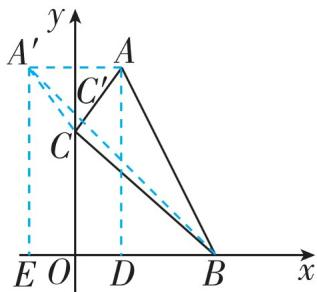

> [!success]- 必刷题
>
> > [!success] **【答案】** C
>
> > [!note]- **【解析】**
> > 【解】(1) 过点 A 作 $AD \perp OB$ 于 D, 如图, 则 $\angle ADB = 90^{\circ}$ . 因为点 A, B 的坐标分别为 (2,8) 和 (6,0), 所以 OD = 2, AD = 8, OB = 6, 所
> >
> > 
> >
> > 以 $BD = 4$ ，所以 $AB = \sqrt{AD^2 + DB^2} = \sqrt{8^2 + 4^2} = 4\sqrt{5}$
> >
> > (2) 因为 AB 长度一定, 所以要使 $\triangle ABC$ 的周长最小, 需 $AC + BC$ 的值最小. 作 A 关于 y 轴的对称点 $A'$ , 连接 $BA'$ 交 y 轴于点 $C'$ , 过点 $A'$ 作 $A'E \perp x$ 轴于点 E, 连接 $A'C$ , 如图. 因为 $AC + BC = A'C + BC \geqslant A'B$ , 所以当 $A', C, B$ 三点共线, 即 C 与 $C'$ 重合时, $\triangle ABC$ 的周长最小, 最小值为 $A'B + AB$ 的值. 由轴对称的性质得 $A'(-2,8)$ , 所以 $E(-2,0)$ . 在 Rt $\triangle A'EB$ 中, $A'E = 8, EB = 8$ , 所以 $A'B = \sqrt{8^{2} + 8^{2}} = 8\sqrt{2}$ , 所以 $\triangle ABC$ 的周长的最小值为 $A'B + AB = 8\sqrt{2} + 4\sqrt{5}$ . 刷素养·
